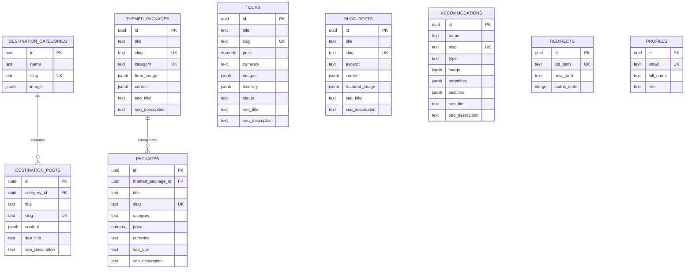

# CMS Discovery & Sanity-to-Postgres Mapping Specification
**Project:** Lindberg Safaris (`lindbergsafaris.com`)  
**Target:** Custom Headless CMS (Supabase Postgres + Next.js Admin + Tiptap + Cloudinary)  
**Date:** November 2026  
**Status:** Step 0 Discovery (Pre-implementation)

---

## 1. Executive Summary & Migration Scope

Lindberg Safaris is migrating its content repository from Sanity Studio to a purpose-built custom CMS integrated directly into `next-app` under the `/admin` route. The persistent data layer will be Supabase Postgres, rich-text management will transition from Sanity Portable Text to Tiptap (persisted as structured JSON/HTML), and binary media will remain hosted on Cloudinary with image URLs and metadata stored in Postgres.

The live website in `next-app/` currently reads content via Sanity GROQ queries in `src/lib/data/index.ts`. To ensure zero downtime and prevent SEO regressions, the current production data and Sanity schemas have been audited to define the target relational schema, document discrepancies between schema declarations and real content, map out dirty slugs and URL anomalies, and design an extensible configuration-driven admin architecture.

---

## 2. Sanity Source Architecture & Dataset Overview

### 2.1 Dataset Summary (`cms-source/data.ndjson`)
The production dataset export (`cms-source/data.ndjson`) contains **167 total documents**:

| Sanity `_type` | Document Count | Published Records | Draft Records | In `schemaTypes/*.ts` | In `schema.json` |
| :--- | :---: | :---: | :---: | :---: | :---: |
| `accommodation` | 42 | 41 | 1 (`drafts.938b63a4...`) | Yes | Yes |
| `fleetVehicle` | 32 | 32 | 0 | Yes | Yes |
| `destinationPost` | 29 | 29 | 0 | Yes | Yes |
| `galleryImage` | 17 | 17 | 0 | Yes | Yes |
| `hotDeal` | 9 | 9 | 0 | Yes | Yes |
| `destinationCategory` | 8 | 8 | 0 | Yes | Yes |
| `teamMember` | 7 | 7 | 0 | Yes | Yes |
| `themedPackage` | 7 | 7 | 0 | Yes | Yes |
| `blogPost` | 6 | 6 | 0 | Yes | Yes |
| `tour` | 5 | 5 | 0 | Yes | Yes |
| `popupOffer` | 5 | 5 | 0 | Yes | Yes |
| `heroSlide` | 0 | 0 | 0 | Yes | Yes |
| `partner` | 0 | 0 | 0 | Yes | Yes |
| `package` | 0 | 0 | 0 | **No** | **No** |
| `service` | 0 | 0 | 0 | Yes (`service.ts`) | **No** |
| **Total** | **167** | **166** | **1** | | |

*Note: Internal Sanity asset descriptors (`sanity.imageAsset`, `sanity.fileAsset`) are empty (0 bytes in `assets.json`), as all media assets across the site reside directly on Cloudinary.*

---

## 3. Deep-Dive Field Specifications (14 Target Types + Additional Types)

Each document type has been analyzed against both the Sanity Studio TypeScript definitions (`cms-source/schemaTypes/*.ts`) and the compiled Sanity JSON schema (`cms-source/schema.json`).

### 3.1 `tour` (Tour Packages)
- **Sanity Title:** Tour
- **Schema Source:** `cms-source/schemaTypes/tour.ts`
- **Record Count in Data:** 5
- **Fields:**
  - `title` (string, required): Display title of the tour (e.g. "LAMU PACKAGE").
  - `slug` (slug, required): Slug object `{ current: string }`, source: `title`, max length 96.
  - `location` (string, required): Geographic destination (e.g. "Lamu", "Mombasa").
  - `description` (text, required): Long overview text.
  - `duration` (string, required): Duration string (e.g. "3 Nights PPS", "10 Nights/11 Days").
  - `groupSize` (string, optional): String descriptor (e.g. "min 2 people").
  - `difficulty` (string, optional): Select dropdown with options `easy`, `moderate`, `challenging`.
  - `price` (number, required): Numeric price (schema comment indicates USD, but actual data contains Kenyan Shillings / KES amounts, e.g. `52186`, `515650`).
  - `rating` (number, optional): Rating score, rule `min(0).max(5)`.
  - `reviews` (number, optional): Review count, rule `min(0)`.
  - `images` (array of objects, optional): Array of Cloudinary image objects `{ url: url, alt: string }`.
  - `highlights` (array of string, optional): Bullet points of highlights.
  - `itinerary` (array of objects, optional): Structured itinerary items with subfields:
    - `day` (number): Day sequence number.
    - `title` (string): Daily stage title.
    - `description` (text): Narrative description of the day.
    - `accommodation` (string): Hotel or camp name.
    - `meals` (string): Meal plan (e.g. "Bed & Breakfast").
  - `included` (array of string, optional): What's included.
  - `excluded` (array of string, optional): What's excluded.
  - `featured` (boolean, optional): Homepage toggle.

### 3.2 `blogPost` (Articles & Stories)
- **Sanity Title:** Blog Post
- **Schema Source:** `cms-source/schemaTypes/blogPost.ts`
- **Record Count in Data:** 6
- **Fields:**
  - `title` (string, required): Headline of the article.
  - `slug` (slug, required): URL slug object `{ current: string }`.
  - `excerpt` (text, required): Short summary, rule `max(200)`.
  - `content` (array of blocks/objects, optional): Portable Text body with embedded custom blocks:
    - `block`: Standard text blocks (headings h2-h4, normal, blockquote, bullet/number lists, bold, em, code, underline, strike, links).
    - `externalImage`: Object `{ url: url, alt: string, caption: string }`.
    - `videoEmbed`: Object `{ url: url (required), caption: string }`.
  - `featuredImage` (object, optional): Object `{ url: url, alt: string }`.
  - `author` (string, required): Author byline (e.g. "lindberg safaris").
  - `category` (string, optional): Category tag (e.g. "travel-tips", "destinations").
  - `publishedAt` (datetime, required): Publication timestamp.
  - `readTime` (string, optional): Reading estimate string (e.g. "5 min read").

### 3.3 `accommodation` (Hotels, Lodges & Camps)
- **Sanity Title:** Accommodation
- **Schema Source:** `cms-source/schemaTypes/accommodation.ts`
- **Record Count in Data:** 42 (41 published, 1 draft)
- **Fields:**
  - `name` (string, optional in schema, populated in 100% of data): Name of property.
  - `slug`: **NOT PRESENT in Sanity schema** and **NOT in data**. (Synthesized by Next.js as `slugify(name)`).
  - `type` (string, optional in schema): Select dropdown with options:
    - `lodges` (Lodge)
    - `holiday-homes` (Holiday Home)
    - `town-hotels` (Town Hotel)
    - `luxury-camps` (Luxury Camp)
    - `resort-hotels` (Resort Hotel)
    - `bush-camps` (Bush Camp)
  - `location` (string, optional): Park or region name (e.g. "Maasai Mara", "Laikipia").
  - `description` (text, optional): Property overview text.
  - `image` (object, optional): Object `{ url: url, alt: string }`.
  - `rating` (number, optional): Rating score, rule `min(1).max(5)`.
  - `amenities` (array of objects, optional): Array of amenities `{ name: string (required), image: { url: url, alt: string } }`. Pre-populated defaults in studio: Restaurant, Swimming pool, Bar and lounge, Airport shuttle.
  - `sections` (array of objects, optional): Array of sub-sections `{ title: string, content: text, images: [{ url: url, alt: string }] }`. (0 records in data have populated this).

### 3.4 `hotDeal` (Time-Sensitive Offers)
- **Sanity Title:** Hot Deal
- **Schema Source:** `cms-source/schemaTypes/hotDeal.ts`
- **Record Count in Data:** 9
- **Fields:**
  - `title` (string, required): Offer headline (e.g. "Maasai Mara", "Diani").
  - `image` (object, required): Object `{ url: url (required), alt: string (required) }`.
  - `whatsappNumber` (string, required): Telephone number with country code (e.g. `+254743377948`).
  - `whatsappMessage` (string, optional): Default prepopulated message.
  - `dealExpiry` (datetime, required): ISO datetime when the deal ends.
  - `tag` (string, optional): Promotional badge (e.g. "ON SALE", "exclusive sale", "limited slots").
  - `isActive` (boolean, optional): Active status toggle.

### 3.5 `popupOffer` (Modal Banners)
- **Sanity Title:** Popup Offer
- **Schema Source:** `cms-source/schemaTypes/popupOffer.ts`
- **Record Count in Data:** 5
- **Fields:**
  - `title` (string, required): Modal title.
  - `description` (text, optional): Promotional copy.
  - `image` (object, optional): Object `{ url: url, alt: string }`.
  - `ctaText` (string, optional): Button label (e.g. "Claim Offer", "BOOK NOW").
  - `ctaLink` (string, optional): Target URL (e.g. "https://www.lindbergsafaris.com/").
  - `isActive` (boolean, optional): Visibility switch.
  - `startDate` (datetime, optional): Schedule start window.
  - `endDate` (datetime, optional): Schedule termination window.

### 3.6 `package` (Individual Holiday Packages)
- **Sanity Title:** None (Ghost Type)
- **Schema Source:** Not defined in `cms-source/schemaTypes/`, not in `schema.json`.
- **Record Count in Data:** 0
- **TypeScript Reference:** Defined in `next-app/src/types/index.ts`:
  - `_id` (string)
  - `title` (string)
  - `category` (string)
  - `duration` (string, optional)
  - `price` (number, optional)
  - `image` (Image object, optional)
  - `description` (string, optional)
- **Context:** Queried by `next-app/src/lib/data/index.ts` (`getPackages()`, `getPackagesByCategory()`) on `/packages/[category]`. In Sanity, this query has always returned `[]`.

### 3.7 `themedPackage` (Themed Category Landing Pages)
- **Sanity Title:** Themed Package
- **Schema Source:** `cms-source/schemaTypes/themedPackage.ts`
- **Record Count in Data:** 7
- **Fields:**
  - `title` (string, required): Package theme title (e.g. "PILGRIMAGES & FAITH JOURNEYS").
  - `slug` (slug, required): Slug object `{ current: string }`.
  - `category` (string, required): Category slug matching: `wildlife`, `climbing`, `cruise`, `adventure`, `pilgrimages`, `corporate`.
  - `heroImage` (object, required): Object `{ url: url (required), alt: string (required) }`.
  - `description` (text, required): Introductory synopsis.
  - `content` (array of blocks/objects, optional): Portable Text body with custom image blocks `{ url: url, alt: text }`.

### 3.8 `teamMember` (Company Staff)
- **Sanity Title:** Team Member
- **Schema Source:** `cms-source/schemaTypes/teamMember.ts`
- **Record Count in Data:** 7
- **Fields:**
  - `name` (string, required): Full name.
  - `role` (string, required): Job title (e.g. "CEO", "Director", "Tour Consultant").
  - `image` (image object, optional): Custom image object containing `{ url: url, alt: text }`.
  - `order` (number, optional): Sort position.

### 3.9 `heroSlide` (Homepage Carousel)
- **Sanity Title:** Hero Slide
- **Schema Source:** `cms-source/schemaTypes/heroSlide.ts`
- **Record Count in Data:** 0 (Frontend currently falls back to hardcoded slides)
- **Fields:**
  - `title` (string, optional): Slide headline.
  - `subtitle` (string, optional): Sub-headline.
  - `image` (url string, optional): Cloudinary URL.
  - `primaryButtonText` (string, optional): Primary CTA label.
  - `primaryButtonLink` (string, optional): Primary CTA destination.
  - `secondaryButtonText` (string, optional): Secondary CTA label.
  - `secondaryButtonLink` (string, optional): Secondary CTA destination.
  - `order` (number, optional): Sort sequence.

### 3.10 `partner` (Affiliates & Certifications)
- **Sanity Title:** Partner
- **Schema Source:** `cms-source/schemaTypes/partner.ts`
- **Record Count in Data:** 0
- **Fields:**
  - `name` (string, optional): Partner organization name.
  - `logo` (url string, optional): Cloudinary logo URL.
  - `website` (url string, optional): Partner website link.
  - `order` (number, optional): Display order.

### 3.11 `galleryImage` (Media Showcase)
- **Sanity Title:** Gallery Image
- **Schema Source:** `cms-source/schemaTypes/galleryImage.ts`
- **Record Count in Data:** 17
- **Fields:**
  - `title` (string, required): Image title/caption.
  - `location` (string, optional): Location where taken.
  - `category` (string, required): Category string (data contains `wildlife`, `scenery`, `tours`).
  - `imageUrl` (url string, required): Direct Cloudinary image URL.
  - `order` (number, optional): Display sequence.

### 3.12 `fleetVehicle` (Transport Vehicles)
- **Sanity Title:** Fleet Vehicle
- **Schema Source:** `cms-source/schemaTypes/fleetVehicle.ts`
- **Record Count in Data:** 32
- **Fields:**
  - `name` (string, required): Vehicle model/descriptor (e.g. "Mercedes-Benz ", "Toyota Land Cruiser").
  - `imageUrl` (url string, required): Direct Cloudinary image URL.
  - `order` (number, optional): Display sequence (values 1–31 in data).

### 3.13 `destinationCategory` (Geographic Regions)
- **Sanity Title:** Destination Category
- **Schema Source:** `cms-source/schemaTypes/destinationCategory.ts`
- **Record Count in Data:** 8
- **Fields:**
  - `name` (string, required): Region name (e.g. "Europe", "Kenya", "Africa").
  - `slug` (slug, required): URL slug object `{ current: string }`.
  - `description` (text, optional): Region description.
  - `image` (image object, optional in schema, unused in data): Sanity image field.
  - `imageUrl` (url string, optional): Direct Cloudinary URL (used in 100% of data).
  - `isFeatured` (boolean, optional): Featured flag (only Kenya has `true`, Asia has `false`, rest null).

### 3.14 `destinationPost` (Specific Destinations)
- **Sanity Title:** Destination Post
- **Schema Source:** `cms-source/schemaTypes/destinationPost.ts`
- **Record Count in Data:** 29
- **Fields:**
  - `title` (string, required): Destination name (e.g. "Maasai Mara", "France").
  - `slug` (slug, required): URL slug object `{ current: string }`.
  - `excerpt` (text, optional): Summary text (populated in 9 of 29 records).
  - `category` (reference, required): Sanity reference `{ _type: 'reference', _ref: '<destinationCategory_id>' }`.
  - `image` (image object, optional in schema, unused in data): Sanity image field.
  - `imageUrl` (url string, optional): Direct Cloudinary URL (used in 100% of data).
  - `tourCount` (number, optional): Count of tours available (populated in 28 of 29 records).
  - `content` (array of blocks/objects, optional): Portable Text body with custom `externalImage` blocks.

### 3.15 Additional Document Types Found in Source
- **`service` (Services Offered):** Defined in `cms-source/schemaTypes/service.ts`, but excluded from `schemaTypes/index.ts` and `schema.json`. Contains 0 records in `data.ndjson`.
  - Fields: `title` (string, required), `description` (text, required), `icon` (string enum: Car, Hotel, Plane, Compass, Map, Shield, Users, Heart), `slug` (string route), `features` (array of strings), `order` (number), `isActive` (boolean).
- **Sanity Asset Metatypes (`schema.json`):** `sanity.imageAsset`, `sanity.fileAsset`, `sanity.imageMetadata`, `sanity.imageCrop`, `sanity.imageHotspot`. These are built-in Sanity system types; no binary assets are hosted in Sanity.

---

## 4. Schema vs. Real Data Discrepancy Analysis

### 4.1 Undeclared Fields in Production Data
1. **`_system` metadata:** Exported on 33 accommodations, 11 destination posts, 8 hot deals, 6 destination categories, 6 fleet vehicles, 3 blog posts, 3 gallery images, 3 popup offers, 3 tours, and 1 themed package. Shape: `{"base": {"id": "...", "rev": "..."}}`. Must be discarded during migration.
2. **`_rev`:** Sanity internal optimistic locking revision string present on all 167 documents. Must be discarded.

### 4.2 Declared Fields Empty or Null in Real Data
1. **`accommodation.sections`:** Defined in schema as an array of sub-pages/sections, but 0 out of 42 records have this field populated.
2. **`accommodation.rating`:** Defined in schema as a number 1–5; only 4 out of 42 records have a rating value set.
3. **`accommodation.location`:** 1 accommodation record has a missing/null location.
4. **`accommodation.amenities`:** 2 records have missing/empty amenities.
5. **`destinationPost.excerpt`:** Only 9 out of 29 records have an excerpt populated.
6. **`destinationCategory.isFeatured`:** Only 2 records have this explicitly set (Kenya: `true`, Asia: `false`); the other 6 records are `null`.
7. **`blogPost.readTime`:** Only 1 out of 6 records has `readTime` populated ("5 min read").
8. **`tour.difficulty`, `groupSize`, `rating`, `reviews`:** Several tours have null values for these fields.
9. **`tour.highlights`, `included`, `excluded`:** Tours like "AFRO NATION 2026" and "Caribbean Dreams Await" have empty arrays (0 items) for highlights, inclusions, and exclusions.

### 4.3 Inconsistent Image Storage Representations
Across the 11 content types with images, there are 5 conflicting storage conventions in the Sanity export:

| Content Type | Field Name in Data | Data Format in `data.ndjson` | Schema Declaration |
| :--- | :--- | :--- | :--- |
| `fleetVehicle` | `imageUrl` | Plain String (Cloudinary URL) | `url` |
| `galleryImage` | `imageUrl` | Plain String (Cloudinary URL) | `url` |
| `destinationCategory` | `imageUrl` | Plain String (Cloudinary URL) | Both `image` (image) & `imageUrl` (url) |
| `destinationPost` | `imageUrl` | Plain String (Cloudinary URL) | Both `image` (image) & `imageUrl` (url) |
| `hotDeal` | `image` | Object `{ url: string }` | Object `{ url: url, alt: string }` |
| `accommodation` | `image` | Object `{ url: string, alt?: string }` | Object `{ url: url, alt: string }` |
| `blogPost` | `featuredImage` | Object `{ url: string, alt?: string }` | Object `{ url: url, alt: string }` |
| `popupOffer` | `image` | Object `{ url: string, alt?: string }` | Object `{ url: url, alt: string }` |
| `themedPackage` | `heroImage` | Object `{ url: string, alt?: string }` | Object `{ url: url, alt: string }` |
| `teamMember` | `image` | Object `{ _type: 'image', url: string }` | Image with custom `{ url, alt }` |
| `tour` | `images` | Array of objects `[{ url: string, alt?: string }]` | Array of objects `[{ url: url, alt: string }]` |
| `accommodation.amenities` | `image` | Object `{ url: string }` (on some items) | Object `{ url: url, alt: string }` |

**Multi-Account Cloudinary Footprint:**
- 99% of images are hosted on Cloudinary account `dbqdpitah` (`https://res.cloudinary.com/dbqdpitah/image/upload/...`).
- `teamMember` images are hosted on Cloudinary account `di5ga8z9i` (`https://res.cloudinary.com/di5ga8z9i/image/upload/...`).
- No images use Sanity's internal asset store (`asset->url` was only used defensively in Next.js queries).

### 4.4 Rich Content & Portable Text Usage
Portable Text (`_type == 'block'`) is utilized in 4 distinct areas:
1. **`blogPost.content`:** Rich narrative text with headings, blockquotes, bullet lists, marks (bold, italic, links), and embedded custom blocks (`externalImage` with caption/alt, and `videoEmbed`).
2. **`destinationPost.content`:** Destination travel guides containing text blocks and embedded `externalImage` objects.
3. **`themedPackage.content`:** Itinerary and package details containing text blocks and embedded custom `image` objects.
4. **`tour.itinerary`:**
   - In `tour.ts` schema: Defined as an array of structured objects (`day`, `title`, `description: text`, `accommodation: string`, `meals: string`).
   - In real data: Only 1 tour ("HIGH ALTITUDE TRAINING PROGRAMME ") has an itinerary (6 days). The other 4 tours have **no itinerary field** at all. In the 1 populated tour, the `description` field is plain string text, but Next.js renders it as a structured collapsible accordion (`TourItinerary.tsx`).

---

## 5. Known Data Problems & Edge Cases Audit

### 5.1 Dirty Slugs Audit
A full audit of all 55 documents with slug fields revealed 3 dirty slugs that violate standard web formatting:

| Content Type | Sanity ID | Title | Existing Slug | Issues | Proposed Clean Slug |
| :--- | :--- | :--- | :--- | :--- | :--- |
| `tour` | `6ded3abe-c4b7-4d01-9496-99a994c4d02d` | LAMU PACKAGE | `VISIT LAMU` | Uppercase, whitespace | `visit-lamu` (keep slug; redirect `/tours/VISIT%20LAMU` and `/tours/VISIT LAMU`) |
| `blogPost` | `0fca651e-99a4-4898-9171-7d854b343381` | Altitude Training in Kenya: Where Adventure Meets Peak Performance | `Altitude Training Kenya` | Uppercase, whitespace | `altitude-training-kenya` (redirect `/blog/Altitude%20Training%20Kenya`) |
| `themedPackage` | `efaebe21-56de-47cd-a6e3-1aa0774b1a64` | PILGRIMAGES & FAITH JOURNEYS | `The-journey-of-faith-transformative-pilgrimage-experiences` | Leading uppercase 'T' | `the-journey-of-faith-transformative-pilgrimage-experiences` (lowercase version) |

In addition, typographical and semantic anomalies in slugs include:
- `destinationPost`: `ambosseli-national-park` (typo: "ambosseli" with double 's').
- Slug collision across distinct scopes:
  - `kenya` is used both as a `destinationCategory` slug (`/regions/kenya`) and a `destinationPost` slug (`/destinations/kenya`).
  - `high-altitude-training-programme` is used both as a `tour` slug (`/tours/high-altitude-training-programme`) and a `themedPackage` slug (`/packages/high-altitude-training-programme`).

### 5.2 Accommodations with No Slug Field (42 Records)
None of the 42 accommodation records in Sanity possess a `slug` field.
- **Published Accommodations (41 records):** Currently accessed via `/accommodation/view/[id]` (which redirects to `/accommodation/${slugify(name)}`) or directly on `/accommodation/[slugify(name)]`.
- **Draft Accommodation (1 record):** `drafts.938b63a4-4605-49f0-8c91-063a1a7f23bb` ("Olare Mara Kempinski").
- **Name Collision:** There are two accommodation records named "Olare Mara Kempinski":
  - Published record: `1fb9709e-50fa-4276-9288-83bc367b876f`
  - Orphaned draft record: `drafts.938b63a4-4605-49f0-8c91-063a1a7f23bb` (its published counterpart was deleted in Sanity).

### 5.3 Tours Currency Null & Pricing Realities
- All 5 tours have `currency == null` (the field does not exist in the documents).
- The Sanity schema description states `"Price in USD"`, but all stored prices are in **Kenyan Shillings (KES)**:
  - LAMU PACKAGE: `52,186`
  - MOMBASA TWASIJA: `36,161`
  - AFRO NATION 2026: `515,650`
  - Caribbean Dreams Await: `640,977`
  - HIGH ALTITUDE TRAINING PROGRAMME: `197,800`

### 5.4 Expired Hot Deals & Popup Offers
- **Hot Deals (9 records):**
  - **100% of hot deals are expired.** Every `dealExpiry` timestamp is in the past (ranging from May 20, 2026 to November 4, 2026, while current time is November 23, 2026).
  - 8 of the 9 expired deals are currently flagged `isActive: true`.
- **Popup Offers (5 records):**
  - **100% of popup offers have passed their `endDate`** (April 2026, May 2026, October 2026).
  - All 5 are currently flagged `isActive: true`.

### 5.5 Duplicate Names & Distribution Gaps
- **Fleet Vehicles:** 32 records contain duplicate vehicle names:
  - `Mercedes-Benz ` (trailing space) appears 3 times.
  - `Mercedes-Benz interior` appears 2 times.
- **Regional Distribution:** The `destinationCategory` "Asia" has **0 destination posts** linked to it, while Europe has 5, and the rest have 4 each.
- **Tour Itineraries:** 4 of the 5 tours have no itinerary data.

---

## 6. Proposed Postgres Schema (Supabase)

### 6.1 Core Design Principles
1. **Universal Metadata Columns:** Every content table includes:
   - `id UUID PRIMARY KEY DEFAULT gen_random_uuid()`
   - `created_at TIMESTAMPTZ NOT NULL DEFAULT now()`
   - `updated_at TIMESTAMPTZ NOT NULL DEFAULT now()` (maintained via trigger)
   - `status TEXT NOT NULL DEFAULT 'draft' CHECK (status IN ('draft', 'published', 'archived'))`
   - `published_at TIMESTAMPTZ`
   - `legacy_sanity_id TEXT UNIQUE` (stores original Sanity `_id` for tracking and idempotent migration)
2. **Slug Uniformity:** All slugs are stored lowercase, trimmed, and hyphenated (`CHECK (slug ~ '^[a-z0-9]+(-[a-z0-9]+)*$')`). Unique indexes enforce uniqueness per type.
3. **Structured Media Standard:** Image fields are stored as `JSONB` with mandatory `url` key when non-null:
   ```json
   {
     "public_id": "v1778182432/sagana_l93hmc",
     "url": "https://res.cloudinary.com/dbqdpitah/image/upload/v1778182432/sagana_l93hmc.jpg",
     "alt": "Sagana River Rafting Experience",
     "width": 1200,
     "height": 800
   }
   ```
   *Constraint:* `CHECK (image IS NULL OR (jsonb_typeof(image) = 'object' AND image ? 'url' AND image->>'url' IS NOT NULL AND length(trim(image->>'url')) > 0))`
4. **Rich Text Standard:** Tiptap document content is stored as `JSONB` representing standard Tiptap JSON nodes, defaulting to `'{"type":"doc","content":[]}'::jsonb`. Rendered server-side via `@tiptap/html` and sanitized.
5. **SEO Fields:** Nullable `seo_title TEXT` and `seo_description TEXT` added to core content tables (`tours`, `blog_posts`, `accommodations`, `destination_posts`, `themed_packages`, `packages`).
6. **Currency Validation:** `CHECK (currency IN ('KES','USD','EUR'))` on `tours` and `packages`.
7. **URL Parity & Redirects:** A dedicated `redirects` table guarantees that dirty slugs and legacy `/accommodation/view/[id]` URLs return HTTP 301.
8. **Updated At Trigger:** Every table has a `BEFORE UPDATE` trigger attached to `update_updated_at_column()`.
9. **Role Isolation:** Helper functions reside in a secure `private` schema with `search_path = ''`, accessible only to authenticated users (not exposed over PostgREST/RPC).

---

### 6.2 Relational Schema Architecture



---

### 6.3 Schema & Table Definitions (16 Tables)

#### Private Schema & Role Functions
```sql
CREATE SCHEMA IF NOT EXISTS private;
REVOKE ALL ON SCHEMA private FROM PUBLIC;
GRANT USAGE ON SCHEMA private TO authenticated;

CREATE OR REPLACE FUNCTION private.is_cms_user() 
RETURNS BOOLEAN AS $$
BEGIN
    RETURN EXISTS (
        SELECT 1 FROM public.profiles 
        WHERE id = auth.uid() 
        AND role IN ('admin', 'editor')
    );
END;
$$ LANGUAGE plpgsql STABLE SECURITY DEFINER SET search_path = '';

CREATE OR REPLACE FUNCTION private.is_cms_admin() 
RETURNS BOOLEAN AS $$
BEGIN
    RETURN EXISTS (
        SELECT 1 FROM public.profiles 
        WHERE id = auth.uid() 
        AND role = 'admin'
    );
END;
$$ LANGUAGE plpgsql STABLE SECURITY DEFINER SET search_path = '';

REVOKE ALL ON FUNCTION private.is_cms_user() FROM PUBLIC;
GRANT EXECUTE ON FUNCTION private.is_cms_user() TO authenticated;

REVOKE ALL ON FUNCTION private.is_cms_admin() FROM PUBLIC;
GRANT EXECUTE ON FUNCTION private.is_cms_admin() TO authenticated;
```

#### Shared Updated At Trigger Function
```sql
CREATE OR REPLACE FUNCTION update_updated_at_column()
RETURNS TRIGGER AS $$
BEGIN
    NEW.updated_at = now();
    RETURN NEW;
END;
$$ LANGUAGE plpgsql;
```

#### Table: `profiles`
```sql
CREATE TABLE profiles (
    id UUID PRIMARY KEY REFERENCES auth.users(id) ON DELETE CASCADE,
    email TEXT NOT NULL UNIQUE,
    full_name TEXT,
    avatar_url TEXT,
    role TEXT NOT NULL CHECK (role IN ('admin', 'editor')), -- NO default
    created_at TIMESTAMPTZ NOT NULL DEFAULT now(),
    updated_at TIMESTAMPTZ NOT NULL DEFAULT now()
);
```

#### Table: `redirects`
```sql
CREATE TABLE redirects (
    id UUID PRIMARY KEY DEFAULT gen_random_uuid(),
    old_path TEXT NOT NULL UNIQUE,
    new_path TEXT NOT NULL,
    status_code INTEGER NOT NULL DEFAULT 301 CHECK (status_code IN (301, 302, 307, 308)),
    created_at TIMESTAMPTZ NOT NULL DEFAULT now(),
    updated_at TIMESTAMPTZ NOT NULL DEFAULT now()
);
CREATE INDEX idx_redirects_old_path ON redirects(old_path);
```

#### Table: `tours`
```sql
CREATE TABLE tours (
    id UUID PRIMARY KEY DEFAULT gen_random_uuid(),
    title TEXT NOT NULL,
    slug TEXT NOT NULL UNIQUE CHECK (slug ~ '^[a-z0-9]+(-[a-z0-9]+)*$'),
    location TEXT NOT NULL,
    description TEXT NOT NULL,
    duration TEXT NOT NULL,
    group_size TEXT,
    difficulty TEXT CHECK (difficulty IN ('easy', 'moderate', 'challenging')),
    price NUMERIC(12, 2) NOT NULL CHECK (price >= 0),
    currency TEXT NOT NULL DEFAULT 'KES' CHECK (currency IN ('KES','USD','EUR')),
    rating NUMERIC(2, 1) CHECK (rating >= 0 AND rating <= 5),
    reviews INTEGER NOT NULL DEFAULT 0 CHECK (reviews >= 0),
    images JSONB NOT NULL DEFAULT '[]'::jsonb,
    highlights TEXT[] NOT NULL DEFAULT '{}',
    itinerary JSONB NOT NULL DEFAULT '[]'::jsonb, -- Array of {day, title, description, accommodation, meals}
    included TEXT[] NOT NULL DEFAULT '{}',
    excluded TEXT[] NOT NULL DEFAULT '{}',
    featured BOOLEAN NOT NULL DEFAULT false,
    seo_title TEXT,
    seo_description TEXT,
    status TEXT NOT NULL DEFAULT 'draft' CHECK (status IN ('draft', 'published', 'archived')),
    published_at TIMESTAMPTZ,
    legacy_sanity_id TEXT UNIQUE,
    created_at TIMESTAMPTZ NOT NULL DEFAULT now(),
    updated_at TIMESTAMPTZ NOT NULL DEFAULT now()
);
CREATE INDEX idx_tours_slug ON tours(slug);
CREATE INDEX idx_tours_status_pub ON tours(status, published_at);
CREATE INDEX idx_tours_featured ON tours(featured) WHERE status = 'published';
```

#### Table: `blog_posts`
```sql
CREATE TABLE blog_posts (
    id UUID PRIMARY KEY DEFAULT gen_random_uuid(),
    title TEXT NOT NULL,
    slug TEXT NOT NULL UNIQUE CHECK (slug ~ '^[a-z0-9]+(-[a-z0-9]+)*$'),
    excerpt TEXT NOT NULL,
    content JSONB NOT NULL DEFAULT '{"type":"doc","content":[]}'::jsonb, -- Tiptap doc
    featured_image JSONB CHECK (featured_image IS NULL OR (jsonb_typeof(featured_image) = 'object' AND featured_image ? 'url' AND featured_image->>'url' IS NOT NULL AND length(trim(featured_image->>'url')) > 0)),
    author TEXT NOT NULL DEFAULT 'Lindberg Safaris',
    category TEXT NOT NULL, -- Migration reports any nulls
    read_time TEXT,
    seo_title TEXT,
    seo_description TEXT,
    status TEXT NOT NULL DEFAULT 'draft' CHECK (status IN ('draft', 'published', 'archived')),
    published_at TIMESTAMPTZ,
    legacy_sanity_id TEXT UNIQUE,
    created_at TIMESTAMPTZ NOT NULL DEFAULT now(),
    updated_at TIMESTAMPTZ NOT NULL DEFAULT now()
);
CREATE INDEX idx_blog_posts_slug ON blog_posts(slug);
CREATE INDEX idx_blog_posts_status_pub ON blog_posts(status, published_at DESC);
CREATE INDEX idx_blog_posts_category ON blog_posts(category);
```

#### Table: `accommodations`
```sql
CREATE TABLE accommodations (
    id UUID PRIMARY KEY DEFAULT gen_random_uuid(),
    name TEXT NOT NULL,
    slug TEXT NOT NULL UNIQUE CHECK (slug ~ '^[a-z0-9]+(-[a-z0-9]+)*$'),
    type TEXT NOT NULL CHECK (type IN ('lodges', 'holiday-homes', 'town-hotels', 'luxury-camps', 'resort-hotels', 'bush-camps')), -- Migration reports any nulls
    location TEXT,
    description TEXT,
    image JSONB CHECK (image IS NULL OR (jsonb_typeof(image) = 'object' AND image ? 'url' AND image->>'url' IS NOT NULL AND length(trim(image->>'url')) > 0)),
    rating NUMERIC(2, 1) CHECK (rating >= 1 AND rating <= 5),
    amenities JSONB NOT NULL DEFAULT '[]'::jsonb, -- Array of {name, image}
    sections JSONB NOT NULL DEFAULT '[]'::jsonb, -- Array of {title, content, images}
    seo_title TEXT,
    seo_description TEXT,
    status TEXT NOT NULL DEFAULT 'draft' CHECK (status IN ('draft', 'published', 'archived')),
    published_at TIMESTAMPTZ,
    legacy_sanity_id TEXT UNIQUE,
    created_at TIMESTAMPTZ NOT NULL DEFAULT now(),
    updated_at TIMESTAMPTZ NOT NULL DEFAULT now()
);
CREATE INDEX idx_accommodations_slug ON accommodations(slug);
CREATE INDEX idx_accommodations_type ON accommodations(type);
CREATE INDEX idx_accommodations_status_pub ON accommodations(status, published_at);
```

#### Table: `hot_deals`
```sql
CREATE TABLE hot_deals (
    id UUID PRIMARY KEY DEFAULT gen_random_uuid(),
    title TEXT NOT NULL,
    image JSONB NOT NULL CHECK (jsonb_typeof(image) = 'object' AND image ? 'url' AND image->>'url' IS NOT NULL AND length(trim(image->>'url')) > 0),
    whatsapp_number TEXT NOT NULL DEFAULT '+254743377948',
    whatsapp_message TEXT,
    deal_expiry TIMESTAMPTZ NOT NULL,
    tag TEXT NOT NULL DEFAULT 'ON SALE',
    is_active BOOLEAN NOT NULL DEFAULT true,
    status TEXT NOT NULL DEFAULT 'draft' CHECK (status IN ('draft', 'published', 'archived')),
    published_at TIMESTAMPTZ,
    legacy_sanity_id TEXT UNIQUE,
    created_at TIMESTAMPTZ NOT NULL DEFAULT now(),
    updated_at TIMESTAMPTZ NOT NULL DEFAULT now()
);
CREATE INDEX idx_hot_deals_status_expiry ON hot_deals(status, is_active, deal_expiry);
```

#### Table: `popup_offers`
```sql
CREATE TABLE popup_offers (
    id UUID PRIMARY KEY DEFAULT gen_random_uuid(),
    title TEXT NOT NULL,
    description TEXT,
    image JSONB CHECK (image IS NULL OR (jsonb_typeof(image) = 'object' AND image ? 'url' AND image->>'url' IS NOT NULL AND length(trim(image->>'url')) > 0)),
    cta_text TEXT NOT NULL DEFAULT 'Claim Offer',
    cta_link TEXT NOT NULL DEFAULT '/contact',
    is_active BOOLEAN NOT NULL DEFAULT true,
    start_date TIMESTAMPTZ,
    end_date TIMESTAMPTZ,
    status TEXT NOT NULL DEFAULT 'draft' CHECK (status IN ('draft', 'published', 'archived')),
    published_at TIMESTAMPTZ,
    legacy_sanity_id TEXT UNIQUE,
    created_at TIMESTAMPTZ NOT NULL DEFAULT now(),
    updated_at TIMESTAMPTZ NOT NULL DEFAULT now()
);
CREATE INDEX idx_popup_offers_active ON popup_offers(status, is_active, start_date, end_date);
```

#### Table: `destination_categories`
```sql
CREATE TABLE destination_categories (
    id UUID PRIMARY KEY DEFAULT gen_random_uuid(),
    name TEXT NOT NULL,
    slug TEXT NOT NULL UNIQUE CHECK (slug ~ '^[a-z0-9]+(-[a-z0-9]+)*$'),
    description TEXT,
    image JSONB CHECK (image IS NULL OR (jsonb_typeof(image) = 'object' AND image ? 'url' AND image->>'url' IS NOT NULL AND length(trim(image->>'url')) > 0)),
    is_featured BOOLEAN NOT NULL DEFAULT false,
    display_order INTEGER NOT NULL DEFAULT 0,
    status TEXT NOT NULL DEFAULT 'draft' CHECK (status IN ('draft', 'published', 'archived')),
    published_at TIMESTAMPTZ,
    legacy_sanity_id TEXT UNIQUE,
    created_at TIMESTAMPTZ NOT NULL DEFAULT now(),
    updated_at TIMESTAMPTZ NOT NULL DEFAULT now()
);
CREATE INDEX idx_dest_categories_slug ON destination_categories(slug);
CREATE INDEX idx_dest_categories_featured ON destination_categories(is_featured) WHERE status = 'published';
```

#### Table: `destination_posts`
```sql
CREATE TABLE destination_posts (
    id UUID PRIMARY KEY DEFAULT gen_random_uuid(),
    category_id UUID NOT NULL REFERENCES destination_categories(id) ON DELETE RESTRICT,
    title TEXT NOT NULL,
    slug TEXT NOT NULL UNIQUE CHECK (slug ~ '^[a-z0-9]+(-[a-z0-9]+)*$'),
    excerpt TEXT,
    image JSONB CHECK (image IS NULL OR (jsonb_typeof(image) = 'object' AND image ? 'url' AND image->>'url' IS NOT NULL AND length(trim(image->>'url')) > 0)),
    tour_count INTEGER NOT NULL DEFAULT 0,
    content JSONB NOT NULL DEFAULT '{"type":"doc","content":[]}'::jsonb, -- Tiptap doc
    seo_title TEXT,
    seo_description TEXT,
    status TEXT NOT NULL DEFAULT 'draft' CHECK (status IN ('draft', 'published', 'archived')),
    published_at TIMESTAMPTZ,
    legacy_sanity_id TEXT UNIQUE,
    created_at TIMESTAMPTZ NOT NULL DEFAULT now(),
    updated_at TIMESTAMPTZ NOT NULL DEFAULT now()
);
CREATE INDEX idx_dest_posts_slug ON destination_posts(slug);
CREATE INDEX idx_dest_posts_category ON destination_posts(category_id);
CREATE INDEX idx_dest_posts_status ON destination_posts(status, published_at);
```

#### Table: `themed_packages`
```sql
CREATE TABLE themed_packages (
    id UUID PRIMARY KEY DEFAULT gen_random_uuid(),
    title TEXT NOT NULL,
    slug TEXT NOT NULL UNIQUE CHECK (slug ~ '^[a-z0-9]+(-[a-z0-9]+)*$'),
    category TEXT NOT NULL UNIQUE CHECK (category IN ('wildlife', 'climbing', 'cruise', 'adventure', 'pilgrimages', 'corporate')),
    hero_image JSONB NOT NULL CHECK (jsonb_typeof(hero_image) = 'object' AND hero_image ? 'url' AND hero_image->>'url' IS NOT NULL AND length(trim(hero_image->>'url')) > 0),
    description TEXT NOT NULL,
    content JSONB NOT NULL DEFAULT '{"type":"doc","content":[]}'::jsonb, -- Tiptap doc
    seo_title TEXT,
    seo_description TEXT,
    status TEXT NOT NULL DEFAULT 'draft' CHECK (status IN ('draft', 'published', 'archived')),
    published_at TIMESTAMPTZ,
    legacy_sanity_id TEXT UNIQUE,
    created_at TIMESTAMPTZ NOT NULL DEFAULT now(),
    updated_at TIMESTAMPTZ NOT NULL DEFAULT now()
);
CREATE INDEX idx_themed_packages_slug ON themed_packages(slug);
CREATE INDEX idx_themed_packages_category ON themed_packages(category);
```

#### Table: `packages`
```sql
CREATE TABLE packages (
    id UUID PRIMARY KEY DEFAULT gen_random_uuid(),
    themed_package_id UUID REFERENCES themed_packages(id) ON DELETE SET NULL,
    title TEXT NOT NULL,
    slug TEXT NOT NULL UNIQUE CHECK (slug ~ '^[a-z0-9]+(-[a-z0-9]+)*$'),
    category TEXT NOT NULL CHECK (category IN ('wildlife', 'climbing', 'cruise', 'adventure', 'pilgrimages', 'corporate')),
    duration TEXT,
    price NUMERIC(12, 2) CHECK (price >= 0),
    currency TEXT NOT NULL DEFAULT 'KES' CHECK (currency IN ('KES','USD','EUR')),
    image JSONB CHECK (image IS NULL OR (jsonb_typeof(image) = 'object' AND image ? 'url' AND image->>'url' IS NOT NULL AND length(trim(image->>'url')) > 0)),
    description TEXT,
    display_order INTEGER NOT NULL DEFAULT 0,
    seo_title TEXT,
    seo_description TEXT,
    status TEXT NOT NULL DEFAULT 'draft' CHECK (status IN ('draft', 'published', 'archived')),
    published_at TIMESTAMPTZ,
    legacy_sanity_id TEXT UNIQUE,
    created_at TIMESTAMPTZ NOT NULL DEFAULT now(),
    updated_at TIMESTAMPTZ NOT NULL DEFAULT now()
);
CREATE INDEX idx_packages_category ON packages(category);
CREATE INDEX idx_packages_slug ON packages(slug);
```

#### Table: `team_members`
```sql
CREATE TABLE team_members (
    id UUID PRIMARY KEY DEFAULT gen_random_uuid(),
    name TEXT NOT NULL,
    role TEXT NOT NULL,
    image JSONB CHECK (image IS NULL OR (jsonb_typeof(image) = 'object' AND image ? 'url' AND image->>'url' IS NOT NULL AND length(trim(image->>'url')) > 0)),
    display_order INTEGER NOT NULL DEFAULT 0,
    status TEXT NOT NULL DEFAULT 'published' CHECK (status IN ('draft', 'published', 'archived')),
    published_at TIMESTAMPTZ,
    legacy_sanity_id TEXT UNIQUE,
    created_at TIMESTAMPTZ NOT NULL DEFAULT now(),
    updated_at TIMESTAMPTZ NOT NULL DEFAULT now()
);
CREATE INDEX idx_team_members_order ON team_members(display_order);
```

#### Table: `hero_slides`
```sql
CREATE TABLE hero_slides (
    id UUID PRIMARY KEY DEFAULT gen_random_uuid(),
    title TEXT NOT NULL,
    subtitle TEXT,
    image JSONB NOT NULL CHECK (jsonb_typeof(image) = 'object' AND image ? 'url' AND image->>'url' IS NOT NULL AND length(trim(image->>'url')) > 0),
    primary_button_text TEXT,
    primary_button_link TEXT,
    secondary_button_text TEXT,
    secondary_button_link TEXT,
    display_order INTEGER NOT NULL DEFAULT 0,
    is_active BOOLEAN NOT NULL DEFAULT true,
    status TEXT NOT NULL DEFAULT 'draft' CHECK (status IN ('draft', 'published', 'archived')),
    published_at TIMESTAMPTZ,
    legacy_sanity_id TEXT UNIQUE,
    created_at TIMESTAMPTZ NOT NULL DEFAULT now(),
    updated_at TIMESTAMPTZ NOT NULL DEFAULT now()
);
CREATE INDEX idx_hero_slides_order ON hero_slides(display_order) WHERE is_active = true;
```

#### Table: `partners`
```sql
CREATE TABLE partners (
    id UUID PRIMARY KEY DEFAULT gen_random_uuid(),
    name TEXT NOT NULL,
    logo JSONB NOT NULL CHECK (jsonb_typeof(logo) = 'object' AND logo ? 'url' AND logo->>'url' IS NOT NULL AND length(trim(logo->>'url')) > 0),
    website TEXT,
    display_order INTEGER NOT NULL DEFAULT 0,
    status TEXT NOT NULL DEFAULT 'published' CHECK (status IN ('draft', 'published', 'archived')),
    published_at TIMESTAMPTZ,
    legacy_sanity_id TEXT UNIQUE,
    created_at TIMESTAMPTZ NOT NULL DEFAULT now(),
    updated_at TIMESTAMPTZ NOT NULL DEFAULT now()
);
CREATE INDEX idx_partners_order ON partners(display_order);
```

#### Table: `gallery_images`
```sql
CREATE TABLE gallery_images (
    id UUID PRIMARY KEY DEFAULT gen_random_uuid(),
    title TEXT NOT NULL,
    location TEXT,
    category TEXT NOT NULL CHECK (category IN ('wildlife', 'scenery', 'tours', 'accommodations', 'adventures')),
    image JSONB NOT NULL CHECK (jsonb_typeof(image) = 'object' AND image ? 'url' AND image->>'url' IS NOT NULL AND length(trim(image->>'url')) > 0),
    display_order INTEGER NOT NULL DEFAULT 0,
    status TEXT NOT NULL DEFAULT 'published' CHECK (status IN ('draft', 'published', 'archived')),
    published_at TIMESTAMPTZ,
    legacy_sanity_id TEXT UNIQUE,
    created_at TIMESTAMPTZ NOT NULL DEFAULT now(),
    updated_at TIMESTAMPTZ NOT NULL DEFAULT now()
);
CREATE INDEX idx_gallery_images_category ON gallery_images(category, display_order);
```

#### Table: `fleet_vehicles`
```sql
CREATE TABLE fleet_vehicles (
    id UUID PRIMARY KEY DEFAULT gen_random_uuid(),
    name TEXT NOT NULL,
    image JSONB NOT NULL CHECK (jsonb_typeof(image) = 'object' AND image ? 'url' AND image->>'url' IS NOT NULL AND length(trim(image->>'url')) > 0),
    display_order INTEGER NOT NULL DEFAULT 0,
    status TEXT NOT NULL DEFAULT 'published' CHECK (status IN ('draft', 'published', 'archived')),
    published_at TIMESTAMPTZ,
    legacy_sanity_id TEXT UNIQUE,
    created_at TIMESTAMPTZ NOT NULL DEFAULT now(),
    updated_at TIMESTAMPTZ NOT NULL DEFAULT now()
);
CREATE INDEX idx_fleet_vehicles_order ON fleet_vehicles(display_order);
```

---

### 6.4 Row Level Security (RLS) Rules

All 16 tables enforce Row Level Security. Helper functions reside in `private` schema and cannot be invoked as public RPC.

#### RLS for `profiles`
- **SELECT:** Users can read their own row (`id = auth.uid()`). Admins can read all rows (`private.is_cms_admin()`). Anon cannot read profiles.
- **INSERT:** Disallowed for all clients (`WITH CHECK (false)`). New profiles are inserted solely by admin invitation API using the Supabase Service Role. No signup trigger.
- **UPDATE:** Admins can update any profile (including changing roles). Users can update their own row (name, avatar) but **no user can change their own role**:
  ```sql
  -- Admin can update any profile and role
  CREATE POLICY "profiles_update_admin" ON public.profiles FOR UPDATE TO authenticated
  USING (private.is_cms_admin())
  WITH CHECK (private.is_cms_admin());

  -- Self-update permitted, but role change strictly blocked
  CREATE POLICY "profiles_update_self" ON public.profiles FOR UPDATE TO authenticated
  USING (id = auth.uid() AND NOT private.is_cms_admin())
  WITH CHECK (
      id = auth.uid() 
      AND role = (SELECT p.role FROM public.profiles p WHERE p.id = auth.uid())
  );
  ```
- **DELETE:** Restricted to admins only (`private.is_cms_admin()`).

#### RLS for Content Tables
(Tours, Blog Posts, Accommodations, Hot Deals, Popup Offers, Destination Categories, Destination Posts, Themed Packages, Packages, Team Members, Hero Slides, Partners, Gallery Images, Fleet Vehicles)
- **SELECT (Public / Anon):** Can only read published rows:
  `USING (status = 'published' AND (published_at IS NULL OR published_at <= now()))`
- **SELECT (CMS Staff):** Can view all rows (including drafts and archived):
  `USING (private.is_cms_user())`
- **INSERT (CMS Staff):** Editors and admins can create content:
  `WITH CHECK (private.is_cms_user())`
- **UPDATE (CMS Staff):** Editors and admins can edit content:
  `USING (private.is_cms_user()) WITH CHECK (private.is_cms_user())`
- **DELETE (Admin Only):** Only admins can permanently delete records. Editors cannot delete:
  `USING (private.is_cms_admin())`

#### RLS for `redirects`
- **SELECT:** Public (anon and authenticated) can read all rows (`USING (true)`).
- **MUTATE (INSERT/UPDATE/DELETE):** CMS staff only (`private.is_cms_user()`).

---

## 7. Admin Content-Type Config Format

To avoid boilerplate and ensure rapid maintenance, each content type is declared once via a unified TypeScript configuration module. From this declaration, the Admin automatically generates:
1. **List View:** Table columns, search input, status badges, faceted filters, and sorting.
2. **Form View:** Layout tabs, Zod validation schemas, React Hook Form bindings, Cloudinary image uploader, and Tiptap rich-text editors.
3. **API Routes:** Next.js route handlers (`GET`, `POST`, `PATCH`, `DELETE`) with RBAC enforcement and on-demand cache revalidation.

### 7.1 Config Engine Type Definitions

```typescript
// next-app/src/lib/cms/types.ts
import { z } from 'zod';

export type FieldType = 
  | 'text' 
  | 'textarea' 
  | 'number' 
  | 'slug' 
  | 'select' 
  | 'boolean' 
  | 'datetime' 
  | 'image' 
  | 'gallery' 
  | 'rich-text' 
  | 'tags' 
  | 'relation' 
  | 'repeater';

export interface BaseFieldConfig {
  name: string;
  label: string;
  type: FieldType;
  description?: string;
  placeholder?: string;
  required?: boolean;
  defaultValue?: any;
  validation?: z.ZodTypeAny;
}

export interface SelectFieldConfig extends BaseFieldConfig {
  type: 'select';
  options: Array<{ label: string; value: string | number }>;
}

export interface SlugFieldConfig extends BaseFieldConfig {
  type: 'slug';
  sourceField: string;
}

export interface RelationFieldConfig extends BaseFieldConfig {
  type: 'relation';
  targetTable: string;
  labelField: string;
  valueField: string;
}

export interface RepeaterFieldConfig extends BaseFieldConfig {
  type: 'repeater';
  subfields: FieldConfig[];
}

export type FieldConfig = 
  | BaseFieldConfig 
  | SelectFieldConfig 
  | SlugFieldConfig 
  | RelationFieldConfig 
  | RepeaterFieldConfig;

export interface ContentTypeConfig {
  slug: string;                 // URL segment (e.g. 'tours')
  tableName: string;            // Supabase table (e.g. 'tours')
  singular: string;             // Label singular ('Tour')
  plural: string;               // Label plural ('Tours')
  icon: string;                 // Lucide icon name ('Compass')
  revalidateTags: string[];     // Next.js ISR tags (e.g. ['tour', 'tours'])
  listView: {
    columns: Array<{
      field: string;
      label: string;
      type: 'text' | 'badge' | 'image' | 'date' | 'currency' | 'boolean';
      sortable?: boolean;
    }>;
    searchFields: string[];
    filters: Array<{
      field: string;
      label: string;
      options: Array<{ label: string; value: string }>;
    }>;
    defaultSort: { field: string; direction: 'asc' | 'desc' };
  };
  form: {
    tabs: Array<{
      id: string;
      label: string;
      fields: FieldConfig[];
    }>;
  };
}
```

### 7.2 Example Content Type Definition (`tours.config.ts`)

```typescript
// next-app/src/lib/cms/configs/tours.config.ts
import { ContentTypeConfig } from '../types';
import { z } from 'zod';

export const tourConfig: ContentTypeConfig = {
  slug: 'tours',
  tableName: 'tours',
  singular: 'Tour Package',
  plural: 'Tour Packages',
  icon: 'Compass',
  revalidateTags: ['tour', 'tours'],
  listView: {
    columns: [
      { field: 'images', label: 'Image', type: 'image' },
      { field: 'title', label: 'Tour Title', type: 'text', sortable: true },
      { field: 'location', label: 'Location', type: 'text', sortable: true },
      { field: 'duration', label: 'Duration', type: 'text' },
      { field: 'price', label: 'Price (KES)', type: 'currency', sortable: true },
      { field: 'featured', label: 'Featured', type: 'boolean' },
      { field: 'status', label: 'Status', type: 'badge', sortable: true },
    ],
    searchFields: ['title', 'location', 'slug'],
    filters: [
      {
        field: 'status',
        label: 'Status',
        options: [
          { label: 'Published', value: 'published' },
          { label: 'Draft', value: 'draft' },
          { label: 'Archived', value: 'archived' },
        ],
      },
      {
        field: 'difficulty',
        label: 'Difficulty',
        options: [
          { label: 'Easy', value: 'easy' },
          { label: 'Moderate', value: 'moderate' },
          { label: 'Challenging', value: 'challenging' },
        ],
      },
    ],
    defaultSort: { field: 'created_at', direction: 'desc' },
  },
  form: {
    tabs: [
      {
        id: 'general',
        label: 'Overview',
        fields: [
          { name: 'title', label: 'Title', type: 'text', required: true, validation: z.string().min(3) },
          { name: 'slug', label: 'URL Slug', type: 'slug', sourceField: 'title', required: true },
          { name: 'location', label: 'Location', type: 'text', required: true },
          { name: 'duration', label: 'Duration', type: 'text', placeholder: 'e.g. 7 Days / 6 Nights', required: true },
          { name: 'price', label: 'Price', type: 'number', required: true, validation: z.number().positive() },
          {
            name: 'currency',
            label: 'Currency',
            type: 'select',
            required: true,
            defaultValue: 'KES',
            options: [
              { label: 'KES (Kenyan Shilling)', value: 'KES' },
              { label: 'USD (US Dollar)', value: 'USD' },
              { label: 'EUR (Euro)', value: 'EUR' },
            ],
          },
          {
            name: 'difficulty',
            label: 'Difficulty',
            type: 'select',
            options: [
              { label: 'Easy', value: 'easy' },
              { label: 'Moderate', value: 'moderate' },
              { label: 'Challenging', value: 'challenging' },
            ],
          },
          { name: 'featured', label: 'Feature on Homepage', type: 'boolean', defaultValue: false },
          { name: 'description', label: 'Detailed Description', type: 'textarea', required: true },
        ],
      },
      {
        id: 'media',
        label: 'Gallery & Media',
        fields: [
          { name: 'images', label: 'Tour Gallery', type: 'gallery', description: 'Upload high-resolution images to Cloudinary' },
        ],
      },
      {
        id: 'itinerary',
        label: 'Itinerary & Inclusions',
        fields: [
          {
            name: 'itinerary',
            label: 'Day-by-Day Itinerary',
            type: 'repeater',
            subfields: [
              { name: 'day', label: 'Day Number', type: 'number', required: true },
              { name: 'title', label: 'Stage Title', type: 'text', required: true },
              { name: 'description', label: 'Daily Narrative', type: 'textarea', required: true },
              { name: 'accommodation', label: 'Lodge / Camp', type: 'text' },
              { name: 'meals', label: 'Meal Plan', type: 'text' },
            ],
          },
          { name: 'highlights', label: 'Highlights', type: 'tags' },
          { name: 'included', label: 'Inclusions', type: 'tags' },
          { name: 'excluded', label: 'Exclusions', type: 'tags' },
        ],
      },
      {
        id: 'seo',
        label: 'SEO Metadata',
        fields: [
          { name: 'seo_title', label: 'Meta Title', type: 'text', placeholder: 'Defaults to tour title if empty' },
          { name: 'seo_description', label: 'Meta Description', type: 'textarea', placeholder: 'Defaults to tour description excerpt if empty' },
        ],
      },
      {
        id: 'publishing',
        label: 'Status & Publishing',
        fields: [
          {
            name: 'status',
            label: 'Workflow Status',
            type: 'select',
            required: true,
            defaultValue: 'draft',
            options: [
              { label: 'Draft', value: 'draft' },
              { label: 'Published', value: 'published' },
              { label: 'Archived', value: 'archived' },
            ],
          },
          { name: 'published_at', label: 'Publication Date', type: 'datetime' },
        ],
      },
    ],
  },
};
```

---

## 8. Implementation Rules & Decisions Agreed

The following engineering decisions have been approved and will guide Step 2 (Migration):

1. **Role Security Architecture:**
   - Role verification functions (`is_cms_user`, `is_cms_admin`) reside in `private` schema with `SET search_path = ''`.
   - `profiles` cannot be created client-side. No signup trigger. Profiles are provisioned exclusively via administrative invite server route using Supabase Service Role.
   - Users cannot modify their own role. Only admins can assign or modify roles.
2. **Table Lifecycle & Architecture:**
   - `audit_logs` and `services` tables dropped.
   - `tour_itineraries` dropped; `itinerary` stored as JSONB array directly in `tours`.
   - Every table features an `updated_at` trigger.
3. **Data Integrity & Normalization Rules (Step 2 Migration):**
   - **Hot Deals & Popups:** Imported with `status = 'archived'` preserving their original historical dates.
   - **Olare Mara Kempinski:** The published record (`1fb9709e...`) is imported; the orphaned draft (`drafts.938b63a4...`) will first be diffed and reported.
   - **Slugs:** Kept as `visit-lamu` (tour), `altitude-training-kenya` (blog), and `the-journey-of-faith-transformative-pilgrimage-experiences` (themed package). Old uppercase and percent-encoded paths are recorded in `redirects`.
   - **Whitespace & Trimming:** All string values (vehicle names like `"Mercedes-Benz "`, location strings, slugs) are trimmed during migration.
   - **Seed Content:** `hero_slides` and `partners` will be seeded from hardcoded components in `next-app`.
   - **Required Fields Reporting:** `accommodations.type` and `blog_posts.category` are required, but any nulls in source data will be reported prior to insert.
4. **Rich Text Pipeline:**
   - Tiptap content rendered on the server via `@tiptap/html` and sanitized prior to injection into Next.js React templates.
