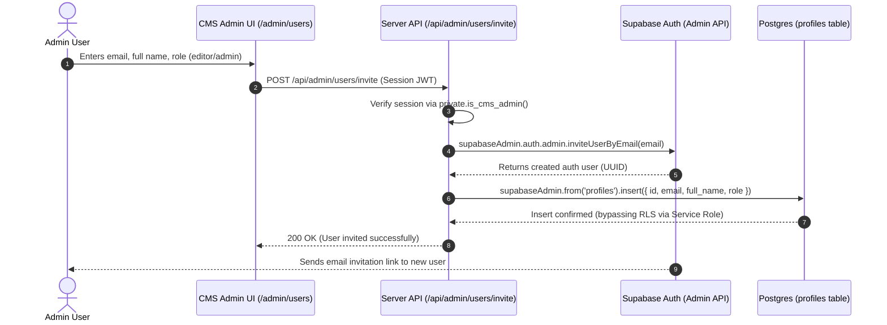

# Supabase CMS Setup & Initial Admin Bootstrap Guide
**Project:** Lindberg Safaris (`lindbergsafaris.com`)  
**Scope:** One-time Supabase Auth configuration, initial admin bootstrap, and user management architecture.

---

## 1. Overview & Security Architecture

Lindberg Safaris CMS utilizes **Supabase Auth** paired with a custom `public.profiles` table governed by strict PostgreSQL Row Level Security (RLS).

### Database Migrations (`0001` to `0007`)
Run the SQL migrations in `supabase/migrations/` in exact numeric order (`0001` through `0007`):
1. `0001_extensions_and_private_schema.sql` — extensions & isolated `private` role helper functions
2. `0002_tables.sql` — 16 CMS & auth tables
3. `0003_triggers.sql` — `BEFORE UPDATE` triggers for `updated_at`
4. `0004_rls_policies.sql` — Row Level Security policies across all tables
5. `0005_indexes.sql` — slug, status, foreign-key, and display order indexes
6. `0006_grants.sql` — `anon`, `authenticated`, and `service_role` table grants
7. `0007_destination_category_display_order.sql` — adds/backfills `display_order` on `destination_categories` and adds `idx_destination_categories_display_order`

- **Two Roles Supported:** `admin` and `editor`.
- **Zero Client-Side Creation:** The `public.profiles` table has no client-side `INSERT` policy (`WITH CHECK (false)`). New staff cannot register or self-assign roles.
- **No Signup Trigger:** To prevent unsolicited or unauthorized user creation, there is no automatic database trigger on `auth.users`.
- **Private Role Isolation:** Role validation functions (`private.is_cms_user()` and `private.is_cms_admin()`) reside in an isolated `private` schema with `SET search_path = ''` and are never exposed as public PostgREST / RPC endpoints.
- **Self-Role Modification Prevented:** Neither admins nor editors can modify their own `role`. Only an admin can change another user's role.

---

## 2. One-Time Bootstrap: Initial Admin Account

Because client-side profile creation is blocked, the very first administrator must be bootstrapped via the Supabase Dashboard and SQL Editor.

### Step 1: Create the User in Supabase Auth
1. Log in to your project at [Supabase Dashboard](https://supabase.com/dashboard).
2. Navigate to **Authentication** → **Users**.
3. Click **Add User** → **Create User**.
4. Enter the administrator's credentials:
   - **Email:** `YOUR_EMAIL` (e.g. `admin@lindbergsafaris.com`)
   - **Password:** Provide a strong temporary or permanent password.
   - **Auto-Confirm User:** Check **Yes / Auto Confirm** (or verify via confirmation link).
5. Copy the newly generated **User UID** (UUID format, e.g. `a1b2c3d4-e5f6-7890-abcd-ef1234567890`).

### Step 2: Provision Admin Profile via Supabase SQL Editor
1. In the Supabase Dashboard, navigate to the **SQL Editor**.
2. Run the following bootstrap query, replacing `YOUR_EMAIL` with the email used in Step 1:

```sql
-- Initial Admin Bootstrap Query
INSERT INTO public.profiles (id, email, full_name, role)
SELECT 
    id, 
    email, 
    'Initial Administrator' AS full_name, 
    'admin' AS role
FROM auth.users 
WHERE email = 'YOUR_EMAIL'
ON CONFLICT (id) DO UPDATE 
SET role = 'admin', full_name = 'Initial Administrator';
```

3. Confirm execution:
```sql
SELECT id, email, role, created_at FROM public.profiles WHERE email = 'YOUR_EMAIL';
```

---

## 3. Disable Public Signups

To ensure that only invited staff members can access the authentication system:

1. In the Supabase Dashboard, navigate to **Authentication** → **Configuration** → **Signers / Providers**.
2. Under **User Signups**, locate **Allow new users to sign up** (Enable Signups).
3. **Toggle OFF / Disable** public signups.
4. Save changes.

> [!IMPORTANT]
> Disabling public signups ensures that external users cannot create accounts via `supabase.auth.signUp()`. All future staff must be explicitly invited by an administrator.

---

## 4. How Additional Users are Invited

All subsequent editors and administrators are invited through the Next.js CMS Admin portal via a secure server route (`/api/admin/users/invite`).

### 4.1 Server-Side Invite Flow


### 4.2 Implementation Reference (Next.js Server Route)
The invitation route must execute server-side using the `SUPABASE_SERVICE_ROLE_KEY`:

```typescript
// next-app/src/app/api/admin/users/invite/route.ts
import { NextResponse } from 'next/server';
import { createClient } from '@supabase/supabase-js';
import { createServerClient } from '@/lib/supabase/server';

// Initialized with privileged service role (SERVER ONLY)
const supabaseAdmin = createClient(
  process.env.NEXT_PUBLIC_SUPABASE_URL!,
  process.env.SUPABASE_SERVICE_ROLE_KEY!,
  { auth: { autoRefreshToken: false, persistSession: false } }
);

export async function POST(request: Request) {
  // 1. Verify caller session and check is_cms_admin
  const supabase = await createServerClient();
  const { data: { user } } = await supabase.auth.getUser();

  if (!user) {
    return NextResponse.json({ error: 'Unauthorized' }, { status: 401 });
  }

  const { data: callerProfile } = await supabase
    .from('profiles')
    .select('role')
    .eq('id', user.id)
    .single();

  if (callerProfile?.role !== 'admin') {
    return NextResponse.json({ error: 'Forbidden: Admin access required' }, { status: 403 });
  }

  // 2. Parse invite payload
  const { email, fullName, role } = await request.json();

  if (!email || !['admin', 'editor'].includes(role)) {
    return NextResponse.json({ error: 'Invalid payload' }, { status: 400 });
  }

  // 3. Send Supabase invitation email
  const { data: inviteData, error: inviteError } = await supabaseAdmin.auth.admin.inviteUserByEmail(email);
  if (inviteError) {
    return NextResponse.json({ error: inviteError.message }, { status: 400 });
  }

  // 4. Provision profile using service role (bypasses RLS)
  const { error: profileError } = await supabaseAdmin
    .from('profiles')
    .insert({
      id: inviteData.user.id,
      email,
      full_name: fullName,
      role,
    });

  if (profileError) {
    return NextResponse.json({ error: profileError.message }, { status: 500 });
  }

  return NextResponse.json({ success: true, userId: inviteData.user.id });
}
```

---

## 5. Critical Environment & Key Security Reminders

> [!CAUTION]
> **NEVER EXPOSE OR COMMIT THE SERVICE ROLE KEY.**
> - `SUPABASE_SERVICE_ROLE_KEY` bypasses all Row Level Security policies.
> - **Never** prefix it with `NEXT_PUBLIC_`.
> - **Never** commit it to Git or pass it into client bundles.
> - Keep it exclusively in server-side `.env.local` or Vercel Environment Variables marked as sensitive.
> - Client-side code must only ever receive and use `NEXT_PUBLIC_SUPABASE_URL` and `NEXT_PUBLIC_SUPABASE_ANON_KEY`.
